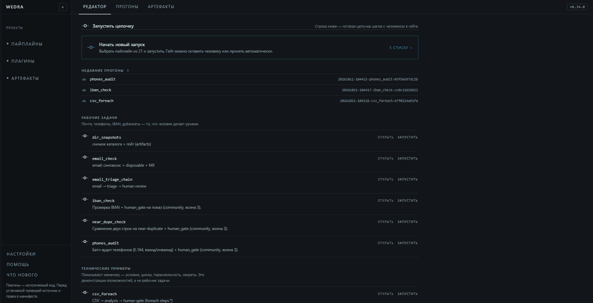
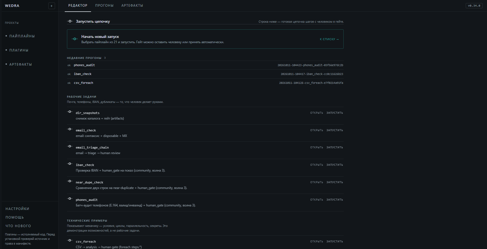
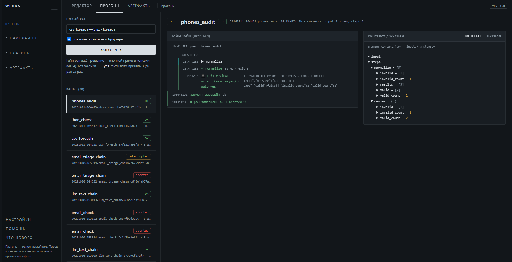
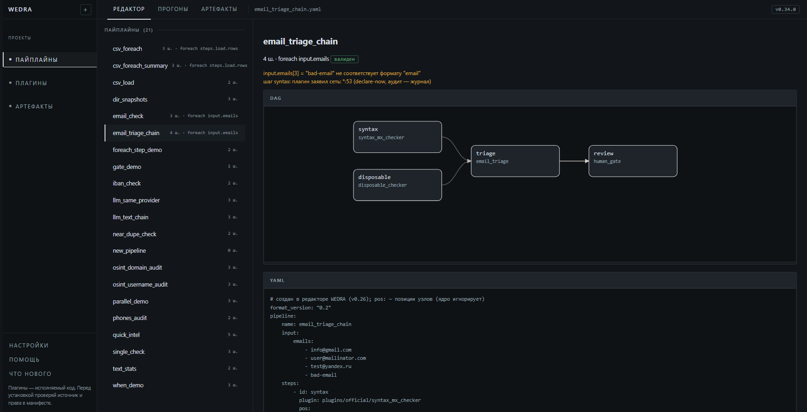
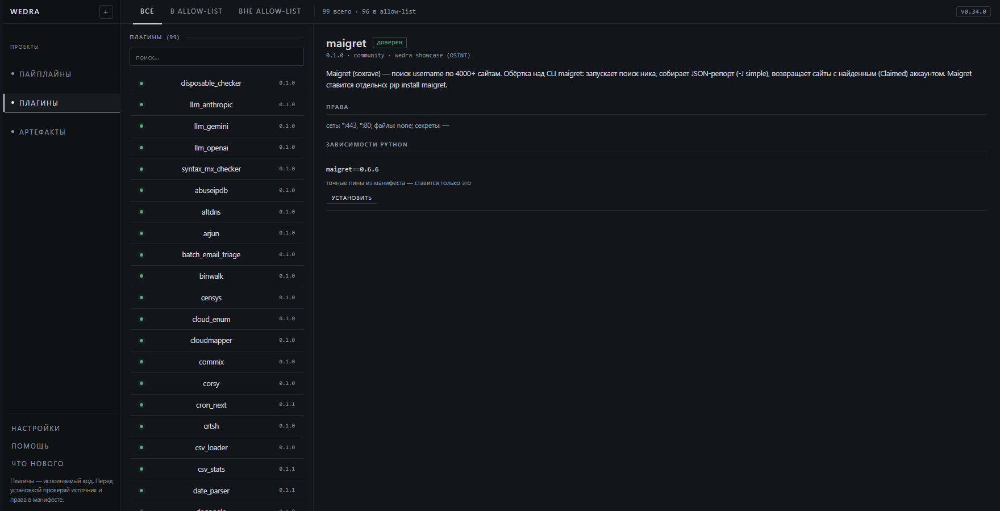
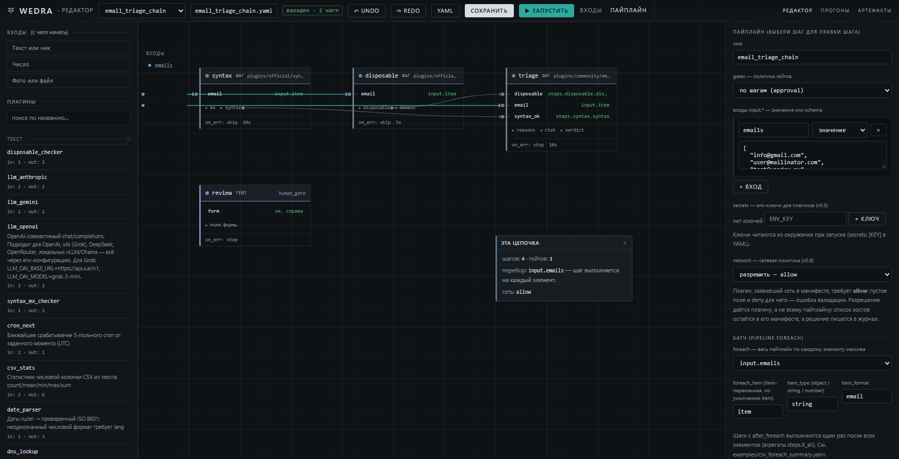
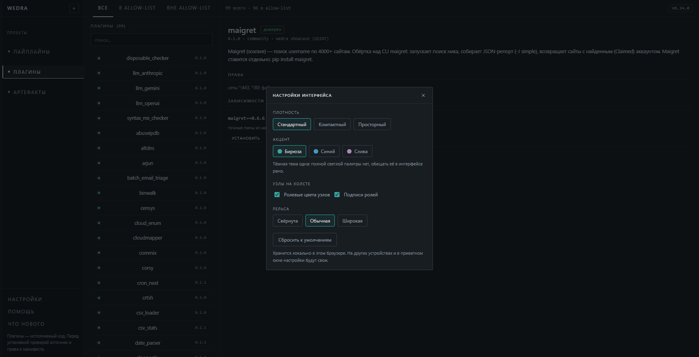
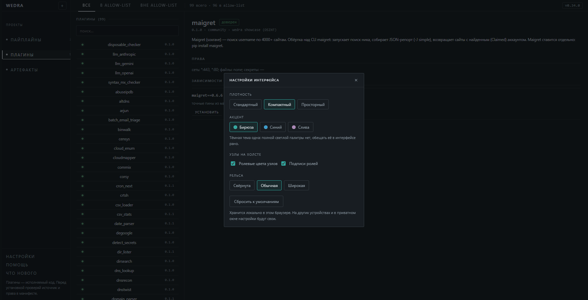

# Nomos

[Русский](README.md) | English

Nomos is a local, deterministic pipeline runner with a human approval gate.
Agents can propose and inspect a plan, while a person remains the decision
point for gated actions.

## Origin and attribution

**Nomos is a fork and descendant of [WEDRA](https://github.com/wykserdex/wedra), originally authored by [wykserdex](https://github.com/wykserdex).** The execution foundation, original plugins, editor, MCP support and many tests come from WEDRA. Original authorship is credited and the upstream MIT copyright notice is preserved in [LICENSE](LICENSE).

Fork development: [jfglag34-png/Nomos](https://github.com/jfglag34-png/Nomos). Nomos adds parallel independent chains, an MCP composer (up to 256 steps), durable scheduling queues, crash-state recovery, webhook idempotency and a persistent Telegram/HTTP outbox.

Use `nomos fleet --config=fleet.yaml` for scheduling and webhook admission. See [Nomos installation and compatibility](docs/nomos.md), [reliability guarantees](docs/fleet-reliability.md) and [MCP composition](docs/mcp-compose.md). The `wedra` CLI, `WEDRA_*` variables, existing data paths and Go module path remain compatible; explicit `NOMOS_*` values take precedence.

## Connectors

PostgreSQL read/write, bounded JSON HTTP APIs and Telegram messages/documents are available as four separately permissioned plugins. See [setup, security and examples](docs/connectors.md). Writes require explicit operator opt-in; secrets stay in environment variables.

## Current contract

- Product version: `0.34.0` from [`VERSION`](VERSION)
- Pipeline/plugin protocol: `0.2` from [`protocol/VERSION`](protocol/VERSION)
- Primary CLI: `nomos` (`wedra` remains compatible)
- Compatibility CLI: `tool` (legacy surface; do not add new behavior there)

The product version and protocol version are independent. See the
[versioning policy](docs/versioning.md).

## Build and run

```bash
go build -o nomos ./cmd/nomos
./nomos version
./nomos plugin list
./nomos pipeline validate examples/email_check.yaml
./nomos pipeline run examples/gate_demo.yaml
./nomos runs list
```

Building from source needs Go 1.26 or newer. That floor is the `go` directive in
`go.mod`, and the `go-floor` CI job builds on exactly it, so the documented
minimum is always the tested one.

The inherited WEDRA tree has 100 plugins: 5 `official` and 95 `community`. Nomos adds four connectors: 104 manifests, 103 registry entries (the inherited csv_column is not registered). Of the original 100, 65 need nothing beyond a bare Python 3, while 35 declare a
third-party donor through `runtime.requires`. Nomos installs a donor only through `runtime.requires`, which
means exactly `pip install package==version` and nothing more: it cannot install
a Perl CLI, a Go program, or a git clone.

In the original catalogue, `runtime.requires` is declared for 13 plugins; both new PostgreSQL connectors also pin their dependencies. For 26 more the donor does exist on
PyPI, so one manifest line each is all that stands between them and working out of
the box — that is declared debt, not a reason to drop them. Only `recon-ng` and
`spiderfoot` really have to be installed by hand: PyPI has no distribution for
either.

The numbers above are a property of the catalog. The state of any given machine is
measured, not asserted: `nomos doctor` recomputes every plugin with the same Python
that runs Nomos itself, and prints how many are ready and what to install. It
installs nothing and runs nothing.

**About the word "community":** the original 100 plugins were written
by the upstream repository owner and live in that same repository — the original registry
entries carry the same `source`, `https://github.com/wykserdex/wedra`, with no
outside sources and no third-party authors. "Community" means shipped outside the
core, that is, everything not in the maintained `plugins/official/` set — not
"written by someone else". The `author` field in the manifests is still a
placeholder (`community`, `community · wedra showcase (OSINT)`, `external
author #4 …`) rather than a person's name; the `official` manifests do not have
that field at all.

The primary CLI supports pipeline validation and execution, plugin registry
operations, resume, the local GUI, and an MCP stdio adapter. Plugin manifests
declare their own component version and protocol compatibility separately.

## What Nomos does not do

The positioning is written plainly, because the disappointment usually comes from
this list rather than from the feature set.

- **The scheduler is local, not cloud.** `nomos fleet` supports cron, intervals and authenticated inbound webhooks with a durable queue. Pending work survives restarts; interrupted work is not blindly replayed. External uptime monitoring is still required. Legacy `nomos schedule` and `nomos daemon` are retained but do not replace fleet.
- **It will not become a cloud, and it is not a SaaS integration sold as a
  product.** No accounts, no telemetry, and no server that holds your data for
  you: it is a binary, a `plugins/` directory, and journals under `var/runs/`.
  The console listens on `127.0.0.1` by default; exposing it is an explicit
  operator flag (`--listen`, `--allow-remote`), not a mode of operation.
  External services are not "Nomos integrations" but ordinary plugins that read
  your key from the environment.
- **It does not chase plugin count.** The 100 plugins in the registry are not a
  showcase: 65 run on a bare Python 3, and 35 declare an external donor, which
  `install` now pulls by itself; 13 more name an installation that `nomos doctor`
  deliberately refuses to vouch for.
  A plugin enters the registry because it passes the conformance gate and
  declares `permissions` honestly, not because it was written.
  `nomos doctor --json` lists every plugin that needs something installed and
  the exact command for it.
- **It does not build cloud orchestration for its own sake.** Orchestration here
  is a DAG inside a single process: steps, `when`, `foreach`, and
  `parallel_group` with a barrier. No distributed scheduler, no queues, no
  service discovery: everything Nomos does happens on one machine, in one run.

**What Nomos does:** a deterministic run of a chain described in YAML, where the
decision to continue stays with a person. Steps and bindings are validated
before the run, and the human is in the loop on `core/human_gate` rather than
reviewing after the fact.

## Pipeline format stability

**What the format version means.** `format_version` in YAML is the version of the
*format protocol*, not the version of the application. The axes are independent:
the product version lives in the `VERSION` file, the protocol version lives in
`protocol/VERSION` and moves rarely. It is checkable: `nomos pipeline validate`
on a file with an unknown `format_version` returns the **error**
`E_FORMAT_VERSION`, not a warning, and an empty field is the warning
`W_FORMAT_VERSION_MISSING`. The supported values are listed in code and do not
grow silently — today exactly `"0.1"` and `"0.2"`.

**What is promised.** The format is not frozen, but the commitment is specific:

> As long as the `format_version` in your file has not changed, a pipeline that
> validated keeps validating and keeps running.

The promise rests on things that can be checked rather than believed:

- **Two values, two live formats.** `"0.1"` is not declared legacy: it is
  accepted on equal terms with `"0.2"`, pipelines using it live in `examples/`,
  and the `pipelines` step (`validate` + `lint` + `plan`) of a full `nomos check`
  runs over them — the same run CI does.
- **A breaking edit cannot be silent.** Per
  [GOVERNANCE.md](../GOVERNANCE.md), a protocol change requires a public
  proposal stating its compatibility impact, migration steps, tests, and the
  version axis it changes; [CONTRIBUTING.md](../CONTRIBUTING.md) additionally
  requires a migration note and compatibility tests. The outcome has to show up
  in `protocol/CHANGELOG.md` together with the new value in
  `protocol/VERSION` and a `protocol/vX.Y/` directory.
- **The contract is checked mechanically.** The `errcodes` gate compares the
  error codes in Go with `protocol/v0.2/ERRORS.md`, the `versions` gate compares
  the versions in README and docs with the repository, and the `schemas` gate
  compares `schemas/` with the examples and manifests.

**What can still change** — the honest list, without which the promise above
would be empty:

- **The format grows.** New optional fields and new error codes can appear —
  that has already happened (`snapshot_lost`, `E_AGENT_EXEC_AUDIT`). Old YAML does
  not break because of it.
- **There is no compatibility in the other direction.** Pipeline parsing is
  strict (`KnownFields(true)` in `internal/pipeline/parser.go`): a Nomos binary
  older than your file refuses to open it rather than ignoring what it does not
  know. An old binary reads old files, not new ones.
- **Error codes and MCP tool names are not a frozen API.** The gates keep the Go
  codes, the published contract, and this README in agreement; that is a
  consistency check, not a ban on adding or renaming.
- **A run depends on the plugins.** If a plugin left the registry or its donor
  tool is not installed, the chain does not run. That is not about the format.
- **The promise does not cover the CLI or the interface.** Command flags, the
  MCP tool set, and console behavior live on the application axis and change
  with a release.
- **The format is not frozen forever.** The project is on the 0.x line, and
  [SECURITY.md](../SECURITY.md) states plainly that only the current line
  receives fixes. A new protocol version is allowed — it just has to be
  announced as described above.

Full breakdown with code references: [docs/format-compatibility.md](docs/format-compatibility.md).

The local console (`nomos gui`) shows runs with a timeline, pipelines with a DAG,
the plugin catalog, and a visual editor:



The full console tour is in [`docs/demo.gif`](docs/demo.gif).

## Repository layout

```text
cmd/nomos/            primary CLI
cmd/wedra/            WEDRA-compatible CLI
cmd/wedragui/         desktop launcher
cmd/tool/             compatibility CLI
internal/pipeline/    model, parsing, validation, planning
internal/execution/   runner and resume
internal/plugin/      plugin process and manifest contract
internal/registry/    registry and install pins
internal/journal/     append-only run journal
internal/gate/        human gate
internal/runctx/      shared context
plugins/official/     maintained core plugins
plugins/community/    everything outside that maintained core
examples/             canonical examples and presets
conformance/fixtures/ public conformance corpus
var/runs/             runtime output, ignored by git
```

`internal/core` is a transitional compatibility layer. The layout and its
compatibility surfaces are documented in [architecture](docs/architecture.md)
and are not to be reorganized without a public proposal and migration plan.

## Screenshots

| | |
|---|---|
|  |  |
| **Home** — what to run next | **Run** — step timeline, live journal and context |
|  |  |
| **Pipeline** — YAML, DAG and validation before launch | **Plugin** — description, permissions and dependencies |
|  | |
| **Editor** — build the chain by dragging, round-trip through the core | |
|  |  |
| **Settings, standard** — density, accent, node roles, rail width | **Settings, compact** — the same screen at a smaller type size and tighter padding |

## Maintainers and safety

Nomos is currently maintained by one primary maintainer. The project is
transparent about that risk and uses public proposals, CI gates, immutable
release tags, and explicit registry admission. See [governance](GOVERNANCE.md)
and [contributing](CONTRIBUTING.md).

Plugin permissions are declarations, not an operating-system sandbox. Review
network, filesystem, and secret permissions before installing a plugin.
A network permission is either every host (`any_host: true`) or no network at
all: there is no per-host egress filter on any platform (see
[SECURITY.md](SECURITY.md#egress-filtering-proxy-built-kernel-enforcement-still-missing)).
Isolation for untrusted external code exists only on Linux (bubblewrap); on
Windows and macOS such code is refused.

A plugin may declare `sandbox: untrusted` in its manifest. Such a plugin only
runs inside an OS sandbox and only with explicit operator consent via
`--allow-untrusted-plugins`; `--deny-untrusted-plugins` refuses every plugin in
the run and is the recommended flag for CI. On Linux the backend is `bwrap`
(read-only filesystem, separate PID/IPC/UTS namespaces, and a network namespace
that is always its own - egress comes from a userspace stack, `slirp4netns`, and
without it a plugin that declared `permissions.network` is refused rather than
run). On macOS and Windows there is no isolation backend, so untrusted code is
refused outright; the former `sandbox-exec` implementation was archived out of
the tree (it is in git history at commit 9d17120) and is not built. A backend that is installed
but cannot isolate on the host (for example, user namespaces are blocked) counts
as absent. The sandbox restricts writes but not reads, and does not filter egress
by destination for a plugin that declares `permissions.network` - it gets
unfiltered egress, just not inside the host's network namespace. So it is not a
complete boundary for hostile code. Report vulnerabilities according to
[SECURITY.md](SECURITY.md).

MCP `compose_pipeline`: validated staged pipeline builder (up to 256 steps), with optional safe artifact saving and whole-chain interval fleet configuration. See docs/mcp-compose.md.
